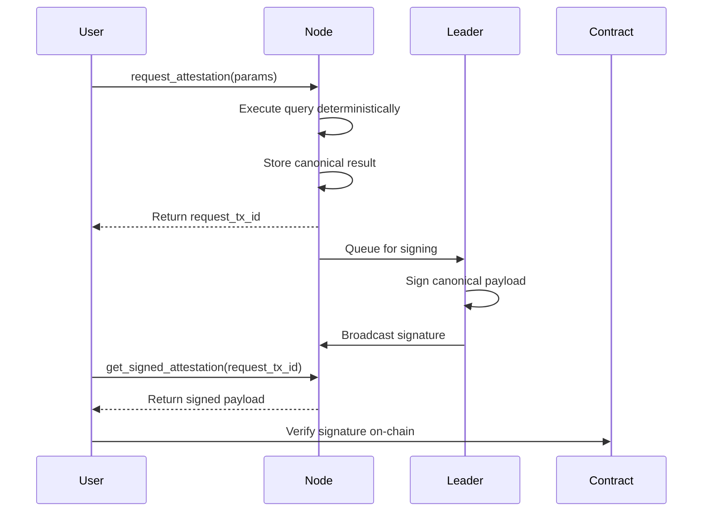

# Attestations

## What Are Attestations?

Attestations are cryptographically signed proofs of query results from TrufNetwork nodes. Instead of trusting raw API responses, downstream applications can verify that a TrufNetwork validator executed a specific query and attested to the results.

**Use Cases:**
- Oracle integrations that require verifiable data feeds
- On-chain settlements based on off-chain query results
- Trustless data bridges between TrufNetwork and other blockchains

## How It Works



**Workflow:**
1. Submit `request_attestation` with query parameters
2. Node executes the query deterministically and stores the result
3. Leader validator signs the canonical payload asynchronously
4. Retrieve the signed payload via `get_signed_attestation`
5. Verify the signature on-chain using the EVM consumer library

## Requesting Attestations

Call the `request_attestation` action with the following parameters:

- **data_provider**: The data provider's address (0x-prefixed)
- **stream_id**: The stream identifier (32 characters)
- **action_name**: The query action to attest. It must be on the `attestation_actions` allowlist (e.g., `get_last_record`, `get_first_record`, `get_high_value`, `get_low_value`, `price_above_threshold`, `index_change_in_range`, and the outcome actions below)
- **args_bytes**: ABI-encoded arguments for the query action. They must start with the same data_provider and stream_id, or the request is refused
- **encrypt_sig**: Must be `false` (encryption not yet supported)
- **max_fee**: Maximum fee you're willing to pay for the attestation

Actions that return more than one row, such as `get_record` and `get_index`, are refused. The node executes the query deterministically to ensure all validators compute identical results.

**Returns:** `request_tx_id` (use this to retrieve the signed attestation) and `attestation_hash`

### Outcome actions (ids 13 to 16)

These actions settle prediction markets and always end them: YES, NO, or INVALID when a capture taken at or after the deadline finds no record. Each returns one row, `(event_time INT8, value NUMERIC(36,18))`, with `value` `1` (YES), `0` (NO) or `-1` (INVALID), encoded like any numeric result.

| id | action | args |
|---|---|---|
| 13 | `index_change_in_range_v2` | `data_provider, stream_id, timestamp, window, tolerance, time_interval, min_change, max_change` |
| 14 | `price_above_threshold_v2` | `data_provider, stream_id, timestamp, window, tolerance, threshold` |
| 15 | `price_below_threshold_v2` | `data_provider, stream_id, timestamp, window, tolerance, threshold` |
| 16 | `value_in_range_v2` | `data_provider, stream_id, timestamp, window, tolerance, min_value, max_value` |

`timestamp` (T), `window` (W), `tolerance` and `time_interval` are INT8 seconds; thresholds and bounds are `NUMERIC(36,18)`, and a NULL bound leaves that tail open. `tolerance` bounds the event time of the record read, and `W` bounds block time. A request before block time T fails, so a market whose settle time is before T still resolves on the value as of T. From T, while no record qualifies, a request fails until `T + W`, and from then on it returns INVALID. The rule applies at capture time: a record written after `T + W` but before the first capture still decides the market, because a record's write time is a block height, not a time. The settlement job captures within an hour of the deadline.

These actions read primitive streams only. A missing, deleted or composed stream reads as no record. Read permissions are not checked, as in `price_above_threshold` and the other id 6 to 9 actions, so every requester gets the same answer; the attestation publishes only the outcome and the event time of the record it used.

Requests and markets with other arguments are refused: every arg present with the exact type; `0 <= T <= block time + 10 years`; `0 < W <= 10 years`; `0 <= tolerance <= 45 days`; `W >= tolerance`. For id 13, `0 < time_interval <= 10 years` and `2 * tolerance < time_interval`. For ids 14 and 15 the threshold is not NULL. For ids 13 and 16 the bounds are not both NULL, and `min < max` when both are set. Here 10 years is 315,360,000 seconds and 45 days 3,888,000.

Consumers read the outcome with `tn_utils.parse_attestation_outcome(result_canonical)`, which returns `1`, `0` or `-1`. `parse_attestation_boolean` refuses these ids.

Once markets are created on these actions, the network owner can stop new markets on the versions they replace by listing them in `retired_market_actions` (migration 064); `create_market` refuses a listed action, and markets that already exist on it still settle:

```sql
INSERT INTO retired_market_actions (action_name) VALUES
  ('price_above_threshold'), ('price_below_threshold'),
  ('value_in_range'), ('index_change_in_range')
ON CONFLICT (action_name) DO NOTHING;
```

## Retrieving Attestations

Call the `get_signed_attestation` action with the `request_tx_id` from your attestation request.

**Returns:** A single payload containing:
- Canonical bytes (8 fields: version, algorithm, block height, data provider, stream ID, action ID, arguments, result)
- 65-byte secp256k1 signature

**Note:** Signing is asynchronous. If the signature isn't ready yet, retry after a short delay (typically completes within seconds).

## SDK Integration

For integration examples and higher-level abstractions, refer to the attestation sections in each SDK's documentation:
- [Go SDK](https://github.com/trufnetwork/sdk-go)
- [TypeScript SDK](https://github.com/trufnetwork/sdk-js)
- [Python SDK](https://github.com/trufnetwork/sdk-py)

## Verifying On-Chain

To verify attestation signatures in your Solidity contracts, use the TrufAttestation library:

**Repository:** [`github.com/trufnetwork/evm-contracts`](https://github.com/trufnetwork/evm-contracts)

**Documentation:** Start with [`docs/AttestationLibrary.md`](https://github.com/trufnetwork/evm-contracts/blob/main/docs/AttestationLibrary.md) for:
- Parsing canonical payloads
- Signature verification
- Decoding data points
- Best practices (validator allowlists, replay protection, freshness checks)

## Technical Details

**Canonical Encoding:** The attestation payload contains 8 fields in a length-prefixed format. The encoding is maintained in [`extensions/tn_attestation/canonical.go`](../extensions/tn_attestation/canonical.go). Any changes to this format must stay in sync with consumer libraries.

**Signature Algorithm:** secp256k1 (same as Ethereum)

**Deterministic Execution:** All query actions are executed with `use_cache=false` to ensure validators compute identical results regardless of cache state. The payload and `attestation_hash` keep the arguments as sent, `use_cache` included, so a market resolves on the capture of the query it stores.

## Current Limitations

- **Single Validator Signature:** Phase 1 provides a single signature from the current leader. Multi-signature support is planned for future phases.
- **No Signature Encryption:** The `encrypt_sig` parameter must be `false`. Encrypted signatures are not yet implemented.
- **Trust Model:** Consumers must implement their own validator trust model (allowlists, rotation policies, etc.). The attestation contains only the signature; verification is the consumer's responsibility.
